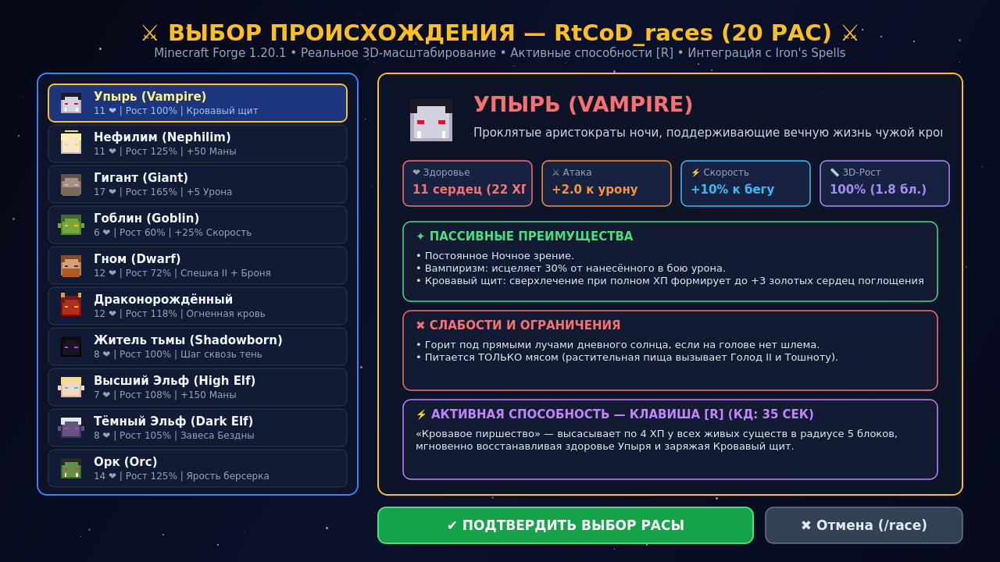

<div align="center">

# ⚔️ RtCoD Races (`rtcod_races`)

**Глобальный RPG-мод на 20 уникальных рас, реальное 3D-масштабирование модели и хитбоксов, пассивные ауры и активные боевые способности для Minecraft Forge 1.20.1**

[](https://files.minecraftforge.net/)
[](https://files.minecraftforge.net/)
[](https://adoptium.net/)
[](https://github.com/Goblin-Inc/RtCoD_races/releases)

<br/>



</div>

---

## 📖 О проекте

**RtCoD Races** — кастомный клиент-серверный мод для проекта **RtCoD (Return to Chronicles of Darkness)** на **Minecraft Forge 1.20.1**, полностью перерабатывающий систему создания и прогрессии персонажа.

При первом входе на сервер перед игроком открывается интерактивное графическое меню (`RaceSelectionScreen`) с кастомными 16×16 пиксель-арт иконками рас, карточками характеристик, списком пассивных эффектов и описанием активного умения.

### ✨ Ключевые возможности
- **20 играбельных фэнтези-рас**: от классических Людей, Эльфов и Дварфов до Вампиров, Демонов, Небожителей, Драконорождённых, Автоматонов и Зверолюдов (Бастет, Ликантроп, Кицунэ, Минотавр, Арахнид).
- **Честный 3D-рост персонажа (`0.75x` – `1.30x`)**:
  - Визуальное масштабирование рендера модели через `RenderPlayerEvent.Pre` (`PoseStack.scale`).
  - Физическое изменение хитбокса и высоты глаз (`EyeHeight`) через `EntityEvent.Size` (Дварфы, Гоблины и Полурослики проходят в проёмы 1.5 блока, а Голиафы, Орки и Минотавры возвышаются над полем боя).
- **Активные расовые способности по клавише `[R]`**: рывки, телепортация в тень, огненное дыхание, вампирский укус, паучий прыжок, берсерк, иллюзорный двойник, каменный бастион и др.
- **Интеграция с `Iron's Spells 'n Spellbooks`**: мягкая (soft-dependency) привязка бонусов к `max_mana`, `mana_regen` и `spell_power` для магических рас.
- **Персистентность через Forge Capabilities**: выбранная раса сохраняется в NBT игрока, автоматически переносится после смерти (`PlayerEvent.Clone`) и синхронизируется по сети (`PacketHandler`).

---

## 🧬 Таблица всех 20 рас

| # | Раса (`ID`) | ❤️ Здоровье | ⚡ Скорость | 🗡️ Атака | 🛡️ Броня | 📏 Рост | 🌟 Пассивные особенности | 🔥 Активная способность `[R]` |
|:-:|:---|:---:|:---:|:---:|:---:|:---:|:---|:---|
| 1 | **Человек** (`human`) | `20 HP` | `100%` | `100%` | `0` | `1.00x` | +25% к получаемому опыту, +2 Удачи | **Воодушевление** *(КД 60с)* — Регенерация II и Скорость I союзникам в радиусе 8 блоков |
| 2 | **Высший Эльф** (`high_elf`) | `18 HP` | `108%` | `95%` | `0` | `1.06x` | +40 Макс. Маны, +20% реген маны, ночное зрение | **Астральный шаг** *(КД 25с)* — Мгновенный блинк на 10 блоков вперёд по взгляду |
| 3 | **Лесной Эльф** (`wood_elf`) | `18 HP` | `115%` | `100%` | `0` | `1.03x` | +25% урона из луков, бесшумный шаг в лесу | **Ветряной залп** *(КД 30с)* — Отскок назад + Невидимость и Скорость II на 6 сек |
| 4 | **Дроу / Тёмный Эльф** (`drow`) | `18 HP` | `110%` | `105%` | `0` | `1.02x` | Ночное зрение, иммунитет к слепоте, слабость на солнце | **Покров Тьмы** *(КД 40с)* — Ослепляет врагов в радиусе 6 блоков и даёт Невидимость |
| 5 | **Дварф** (`dwarf`) | `26 HP` | `90%` | `110%` | `+4` | `0.82x` | Спешка II под землёй, +30% стойкости к отбрасыванию | **Каменный Бастион** *(КД 75с)* — Сопротивление III и Огнестойкость на 10 сек |
| 6 | **Орк** (`orc`) | `28 HP` | `98%` | `125%` | `+2` | `1.18x` | Повышенный урон в ближнем бою, голод тратится быстрее | **Кровавый рёв** *(КД 60с)* — Сила II и Скорость II на 12 сек, отталкивает врагов |
| 7 | **Гоблин** (`goblin`) | `16 HP` | `122%` | `90%` | `0` | `0.75x` | Проходит в проёмы 1.5 блока, +20% скорости атаки | **Грязный трюк** *(КД 25с)* — Рывок вперёд + Отравление и Замедление цели |
| 8 | **Демон** (`demon`) | `24 HP` | `105%` | `115%` | `+2` | `1.12x` | Полный иммунитет к огню и лаве, урон от воды/дождя | **Адское кольцо** *(КД 45с)* — Огненный взрыв вокруг игрока и поджог врагов на 8 сек |
| 9 | **Вампир** (`vampire`) | `22 HP` | `112%` | `110%` | `0` | `1.02x` | Вампиризм (15% от урона ночью), горит на солнце без шлема | **Кровавый укус** *(КД 30с)* — Похищает 6 HP у цели вблизи и накладывает Слабость |
| 10 | **Нежить** (`undead`) | `24 HP` | `95%` | `105%` | `+2` | `1.00x` | Не тонет, иммунитет к яду и голоду, горит днём | **Могильный холод** *(КД 45с)* — Замораживает и иссушает врагов в радиусе 5 блоков |
| 11 | **Ликантроп** (`lycanthrope`) | `26 HP` | `115%` | `120%` | `+2` | `1.15x` | Ночью получает Силу I и Регенерацию I, бонус к прыжку | **Звериный рывок** *(КД 20с)* — Длинный прыжок хищника с кровотечением по площади |
| 12 | **Драконорождённый** (`dragonborn`) | `26 HP` | `100%` | `115%` | `+4` | `1.16x` | Природная чешуя (+4 брони), огнестойкость, +10% силы чар | **Дыхание Дракона** *(КД 40с)* — Конус пламени перед игроком (чистый + огненный урон) |
| 13 | **Зверолюд Бастет** (`bastet`) | `18 HP` | `120%` | `105%` | `0` | `0.95x` | Полный иммунитет к урону от падения, ночное зрение | **Кошачьи рефлексы** *(КД 30с)* — Уклонение + Скорость III и Прыгучесть III на 8 сек |
| 14 | **Кицунэ** (`kitsune`) | `18 HP` | `114%` | `95%` | `0` | `0.96x` | +35 Макс. Маны, +15% силы заклинаний, лисий огонь | **лисьи Огни** *(КД 35с)* — Иллюзорный рывок + самонаводящиеся магические сгустки |
| 15 | **Голиаф** (`goliath`) | `32 HP` | `92%` | `120%` | `+4` | `1.28x` | Иммунитет к обморожению, +50% сопротивления отбрасыванию | **Удар Титана** *(КД 50с)* — Удар по земле, подбрасывающий всех врагов вокруг |
| 16 | **Автоматон** (`automaton`) | `28 HP` | `90%` | `110%` | `+6` | `1.08x` | Не нуждается в воздухе, иммунитет к яду и иссушению | **Перегрузка ядра** *(КД 60с)* — Электрический щит + Скорость II и Спешка II |
| 17 | **Небожитель** (`celestial`) | `20 HP` | `105%` | `100%` | `+2` | `1.08x` | Плавное падение при зажатом Shift, бонус к магии Света | **Благословение Света** *(КД 60с)* — Исцеление 8 HP и Золотые сердца себе и союзникам |
| 18 | **Арахнид** (`arachnid`) | `20 HP` | `110%` | `105%` | `+1` | `1.04x` | Лазание по вертикальным стенам, иммунитет к паутине и яду | **Кокон Ткача** *(КД 30с)* — Обездвиживает цель паутиной и отравляет |
| 19 | **Полурослик** (`halfling`) | `16 HP` | `112%` | `90%` | `0` | `0.78x` | +3 Удачи, скрытность, сниженный радиус агрессии мобов | **Счастливый случай** *(КД 45с)* — Невидимость + Поглощение II + снятие негативных чар |
| 20 | **Минотавр** (`minotaur`) | `30 HP` | `102%` | `125%` | `+3` | `1.30x` | Пробивание щитов в спринте, сокрушительный ближний бой | **Таран Лабиринта** *(КД 35с)* — Стремительный таран с оглушением и отбрасыванием |

---

## 🎮 Управление и команды

| Действие / Команда | Описание |Права доступа |
|---|---|---|
| Клавиша **`[R]`** *(настраивается в Controls)* | Активация расовой способности с отображением кулдауна на HUD | Все игроки |
| `/race` | Открыть меню информации о текущей расе (или выбор расы, если ещё не выбрана) | Все игроки |
| `/race gui` | Принудительно открыть GUI смены расы | OP (уровень 2+) |
| `/race set <player> <race_id>` | Назначить игроку указанную расу с мгновенным пересчётом статов и роста | OP (уровень 2+) |
| `/race reset <player>` | Сбросить расу игрока и открыть ему окно первичного выбора | OP (уровень 2+) |
| `/race info [player]` | Вывести в чат подробную статистику текущей расы игрока | Все игроки |

---

## 🏗️ Архитектура проекта

```
RtCoD_races/
├── src/main/java/com/rtcod/races/
│   ├── RtCoDRacesMod.java          # Точка входа @Mod("rtcod_races"), регистрация шин событий
│   ├── race/
│   │   ├── Race.java               # Enum/реестр 20 рас: атрибуты, рост, иконки, описания
│   │   ├── RaceAttributes.java     # Модификаторы AttributeModifier (HP, Speed, Armor, Attack, Mana)
│   │   └── RaceAbilityHandler.java # Серверная логика 20 активных способностей и кулдаунов
│   ├── capability/
│   │   ├── PlayerRaceData.java     # Хранение выбранной расы и таймеров в NBT
│   │   └── RaceCapability.java     # Регистрация Forge Capability и клонирование при респавне
│   ├── client/
│   │   ├── RaceSelectionScreen.java# Полноэкранный GUI выбора расы с 16x16 иконками и скроллом
│   │   ├── ClientEvents.java       # Масштабирование рендера модели (RenderPlayerEvent) + HUD
│   │   └── KeyBindings.java        # Регистрация клавиши [R] (key.rtcod_races.ability)
│   ├── event/
│   │   └── CommonEvents.java       # EntityEvent.Size (3D-хитбокс), солнечный ожог, пассивки
│   ├── command/
│   │   └── RaceCommand.java        # Бригадир-команды /race set, /race reset, /race gui
│   └── network/
│       ├── PacketHandler.java      # Канал SimpleChannel (протокол синхронизации)
│       ├── SelectRacePacket.java   # C2S пакет выбора расы из GUI
│       ├── UseAbilityPacket.java   # C2S пакет нажатия клавиши [R]
│       └── SyncRacePacket.java     # S2C синхронизация расы и масштаба всем клиентам в трекере
└── src/main/resources/
    ├── META-INF/mods.toml
    └── assets/rtcod_races/
        ├── lang/ru_ru.json, en_us.json
        └── textures/gui/races/     # 20 авторских 16x16 пиксель-арт иконок рас
```

---

## 🚀 Установка и сборка

### Готовый `.jar` из Releases
1. Перейдите в раздел [**Releases**](https://github.com/Goblin-Inc/RtCoD_races/releases) и скачайте `rtcod_races-1.2.0.jar`.
2. Поместите файл в папку `mods/` как на **сервере**, так и в **клиентской сборке** (Forge `1.20.1 - 47.4.13+`).

### Сборка из исходников
```bash
git clone https://github.com/Goblin-Inc/RtCoD_races.git
cd RtCoD_races
./gradlew build
# Готовый мод появится в build/libs/rtcod_races-1.2.0.jar
```

---

## 📋 Changelog

### `v1.2.0` — Полноценный релиз 20 рас и 3D-масштабирования *(Текущая версия)*
- **Добавлено**: Расширен ростер рас до **20 уникальных архетипов** (добавлены `bastet`, `kitsune`, `goliath`, `automaton`, `celestial`, `arachnid`, `halfling`, `minotaur`).
- **Добавлено**: Авторские 16×16 пиксель-арт иконки (`assets/rtcod_races/textures/gui/races/*.png`) для каждой расы в `RaceSelectionScreen`.
- **Улучшено**: Синхронизация `EntityEvent.Size` и `refreshDimensions()` при смене расы без необходимости перезахода на сервер.
- **Улучшено**: Мягкая интеграция с атрибутами `Iron's Spells 'n Spellbooks` (`max_mana`, `mana_regen`, `spell_power`).

### `v1.1.0` — Активные способности и сетевая синхронизация
- **Добавлено**: Клавиша `[R]` (`UseAbilityPacket`) и серверный обработчик кулдаунов для активных умений.
- **Добавлено**: Отображение чужих рас и их 3D-роста у других игроков в мультиплеере (`PlayerEvent.StartTracking`).
- **Исправлено**: Сохранение выбранной расы при смерти и возвращении из Энда (`PlayerEvent.Clone`).

### `v1.0.0` — Базовый прототип
- Первичная реализация Forge Capability, 12 базовых рас, модификаторов здоровья/скорости и команды `/race`.

---

<div align="center">
Разработано специально для сервера <b>RtCoD</b> • Автор: <a href="https://github.com/Goblin-Inc">@Goblin-Inc</a>
</div>
